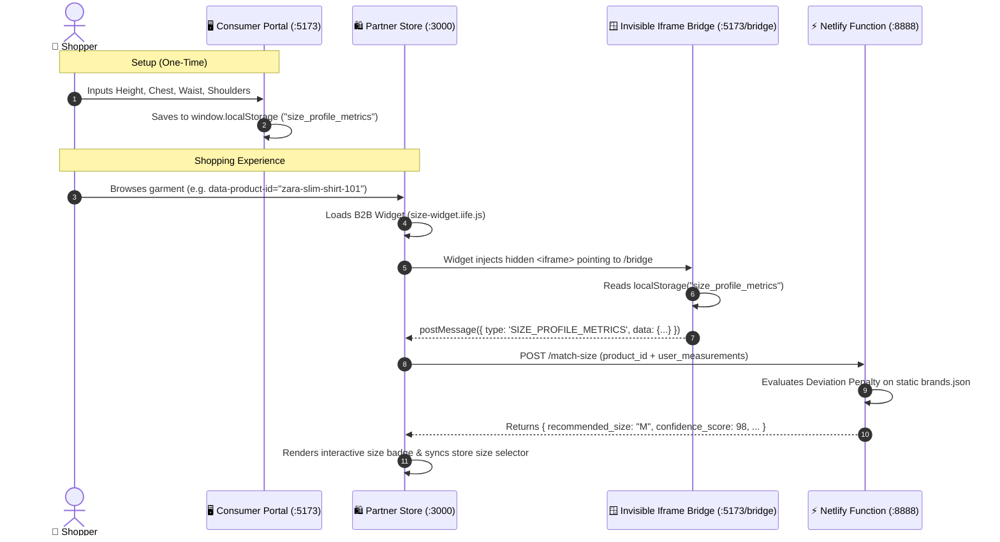

# Universal Size Profile (Zero-DB SaaS Prototype)

An end-to-end, privacy-first sizing engine that matches shoppers to their exact garment size across partner e-commerce stores **without requiring any database, user accounts, or backend credentials**.

---

## 🏗 System Architecture (Zero-DB Protocol)



---

## 📦 Monorepo Workspace Structure

Managed via `npm` workspaces:

```
sizer/
├── apps/
│   ├── consumer-portal/        # React + Vite + Tailwind CSS portal
│   │   ├── src/
│   │   │   ├── components/
│   │   │   │   ├── Bridge.jsx  # Route /bridge: reads localStorage & broadcasts postMessage
│   │   │   │   ├── SizeForm.jsx# Interactive measurement input (cm / in)
│   │   │   │   ├── ProfileCard.jsx
│   │   │   │   └── Header.jsx
│   │   │   ├── App.jsx
│   │   │   └── main.jsx
│   │   └── public/bridge.html  # Standalone static fallback bridge
│   │
│   └── b2b-widget/             # Injectable embeddable widget for partner sites
│       ├── src/
│       │   ├── widget.js       # Injects iframe, receives postMessage, calls API, mounts DOM
│       │   └── styles.js       # Self-contained injected CSS styles
│       └── vite.config.js      # Configured to output a single IIFE bundle
│
├── packages/
│   └── api/                    # Netlify Functions & Static Data
│       ├── data/
│       │   └── brands.json     # Mock sizing charts (Zara, H&M, Uniqlo)
│       ├── functions/
│       │   └── match-size.js   # Serverless matching algorithm with deviation penalties
│       └── server.js           # Local HTTP runner for Netlify function
│
├── demo/
│   └── index.html              # Dummy e-commerce partner store (sandbox test page)
├── scripts/
│   └── serve-demo.js           # Orchestrates all 3 origins (:3000, :5173, :8888)
├── test-e2e.js                 # Automated 31-point end-to-end verification suite
└── package.json                # Root monorepo workspace configuration
```

---

## ⚡ Execution Phases Breakdown

### Phase 1: Static Brand Data (`packages/api/data/brands.json`)
- Static JSON array containing detailed size charts for **Zara**, **H&M**, and **Uniqlo**.
- Min/max thresholds across **Chest**, **Waist**, **Shoulders**, and **Height** for sizes `XS`, `S`, `M`, `L`, `XL`, and `XXL`.
- Includes product catalog mappings (e.g., `zara-slim-shirt-101`, `hm-relaxed-tee-202`, `uniqlo-oxford-303`).

### Phase 2: Serverless Matching Engine (`packages/api/functions/match-size.js`)
- Serverless Netlify Function accepting POST requests with `product_category` (or `product_id`) and `user_measurements`.
- **Deviation Penalty Algorithm**:
  $$\text{penalty} = \sum (\text{deviation}_i \times \text{weight}_i)^{1.8}$$
  - If a user measurement is within $[min, max]$, deviation is `0`.
  - Otherwise, computes distance from closest boundary, heavily weighted on chest and shoulders.
  - Automatically normalizes inches (`in`) to centimeters (`cm`).
  - Returns `recommended_size`, `confidence_score`, and per-metric fit assessments (`ideal`, `snug`, `loose`).
- Includes CORS preflight (`OPTIONS`) handling with `Access-Control-Allow-Origin: *`.

### Phase 3: Consumer Portal (`apps/consumer-portal`)
- React + Tailwind CSS web application.
- Supports measurement entry (Height, Chest, Waist, Shoulders) in either **Centimeters** or **Inches** with real-time conversion.
- Saves payload directly to `window.localStorage` under key `size_profile_metrics` (**no backend / no DB needed**).
- Hidden `/bridge` route (`Bridge.jsx` & `bridge.html`) reads localStorage and dispatches data to parent window via `window.parent.postMessage()`.

### Phase 4: B2B Injectable Widget (`apps/b2b-widget`)
- Vite outputs a single, self-contained IIFE bundle (`dist/size-widget.iife.js`).
- Injects an invisible `<iframe>` pointing to `/bridge`.
- Listens for `message` events containing `SIZE_PROFILE_METRICS`.
- Automatically calls `match-size.js` with measurements and `data-product-id`.
- Dynamically renders a size badge, match confidence percentage, and fit breakdown in partner DOM.
- Auto-selects corresponding size on partner store native selectors.

### Phase 5: Local Sandbox Testing (`demo/index.html` & `scripts/serve-demo.js`)
- Fully working dummy partner store with brand switcher, product gallery, and native size selector.
- Demonstrates true cross-origin security isolation across three local ports:
  - Partner Store: `http://localhost:3000`
  - Consumer Portal & Bridge: `http://localhost:5173`
  - Netlify API Function: `http://localhost:8888`

---

## 🚀 Quickstart & Commands

### 1. Run All Tests
```bash
# Run API unit tests + complete 31-point E2E verification
npm test
```

### 2. Build All Packages
```bash
npm run build
```

### 3. Launch Complete Sandbox Demo
```bash
npm run demo
```
This boots all three services:
- **Partner E-Commerce Store**: Open [http://localhost:3000](http://localhost:3000)
- **Consumer Size Portal**: Open [http://localhost:5173](http://localhost:5173)
- **Iframe Bridge Diagnostic**: Open [http://localhost:5173/bridge](http://localhost:5173/bridge)
- **Netlify Function API**: [http://localhost:8888/.netlify/functions/match-size](http://localhost:8888/.netlify/functions/match-size)
